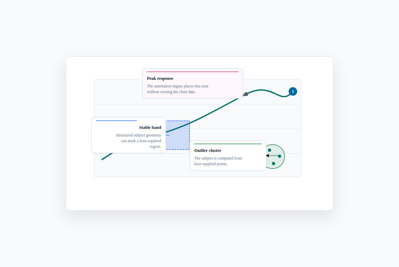

# Bronto Annotations

**Explain an existing chart, diagram, or interface without rebuilding it.**

[Website](https://ponchia.github.io/bronto-annotations/) ·
[Try placement](https://ponchia.github.io/bronto-annotations/#playground) ·
[Try editing](https://ponchia.github.io/bronto-annotations/examples/react-incremental/) ·
[Documentation](https://ponchia.github.io/bronto-annotations/docs/) ·
[Support development](FUNDING.md)

[](https://www.npmjs.com/package/@ponchia/annotations)
[](https://github.com/Ponchia/bronto-annotations/actions/workflows/ci.yml)
[](LICENSE)



`@ponchia/annotations` is a headless TypeScript engine for explanatory notes.
Your application supplies points, boxes, paths, or rendered host geometry;
the engine places notes and connectors around it. Render the result as SVG
or through the optional React layer.

It does not render charts or provide a design system. Your app owns graph
layout, state, and persistence.
For a single fixed label or tooltip, your chart library may already be enough.

## Install

```bash
npm install @ponchia/annotations@0.8.2
```

ES modules only; the root import is DOM-free with no runtime dependencies.
React and adapter peer packages are optional. See [compatibility](docs/compatibility.md)
for tested versions. These docs and demos follow `main`; the
[0.8.2 guides](https://github.com/Ponchia/bronto-annotations/blob/v0.8.2/docs/README.md)
match this install. [Upgrading from 0.6?](docs/migration-0.7.md)

## Core Usage

In a TypeScript browser app with CSS imports, put the code below in `main.ts`.
To try it in a new project, use Node 22.12.0 or newer:

```bash
mkdir annotation-demo
cd annotation-demo
npm init -y
npm install @ponchia/annotations@0.8.2
npm install --save-dev vite@8
```

Create `index.html`:

```html
<!doctype html>
<html lang="en">
  <head>
    <meta charset="UTF-8" />
    <meta name="viewport" content="width=device-width, initial-scale=1" />
    <title>My first annotation</title>
    <link rel="icon" href="data:," />
  </head>
  <body>
    <script type="module" src="/main.ts"></script>
  </body>
</html>
```

Create `main.ts` beside it:

```ts
import {
  resolveAnnotationLayout,
  renderAnnotationsSvg,
  type Annotation
} from '@ponchia/annotations';
import '@ponchia/annotations/bronto.css';

const annotations: Annotation[] = [{
  id: 'peak',
  anchor: { type: 'point', point: { x: 60, y: 120 } },
  note: { title: 'Peak response', body: 'An explanation attached to this point.' },
  placement: { side: 'right' }
}];

const layout = resolveAnnotationLayout({
  annotations,
  bounds: { x: 0, y: 0, width: 400, height: 240 },
  padding: 16
});

const container = document.createElement('div');
container.style.maxWidth = '640px';
container.style.fontFamily = 'system-ui, sans-serif';
container.style.aspectRatio = '400 / 240';
container.innerHTML = renderAnnotationsSvg(layout, {
  title: 'An annotated point',
  markerIdPrefix: 'first-annotation'
});
document.body.append(container);
```

Run `npx vite --host 127.0.0.1` and open the printed URL. You should see a
**Peak response** note and connector. The point coordinates stand in for the
geometry your chart would supply. Continue with [coordinate basics](docs/getting-started.md#coordinate-and-layout-basics)
or attach a note to an [existing surface](docs/context-quickstart.md).

## React

Use `AnnotationLayer` from `@ponchia/annotations/react` with your application's
`react` and `react-dom`. Start with the [complete component](docs/getting-started.md#use-it-in-react)
or the [rendering and editing guide](docs/react-guide.md). The
[interactive demo](https://ponchia.github.io/bronto-annotations/examples/react-incremental/)
shows host-owned editing, undo/redo, and JSON import/export.

## Adapters

Choose only the entry point you need. Host libraries are not imported by the core.

| Existing surface | Import | Runnable source |
| --- | --- | --- |
| SVG / host geometry | `@ponchia/annotations` | [SVG](examples/svg-basic/) |
| React | `@ponchia/annotations/react` | [React](examples/react-basic/) |
| DOM / report regions | `@ponchia/annotations/dom` | [DOM](examples/dom-basic/) |
| Vega / Vega-Lite | `@ponchia/annotations/vega` | [Vega](examples/vega-basic/) |
| Mermaid | `@ponchia/annotations/mermaid` | [Mermaid](examples/mermaid-basic/) |
| D2 | `@ponchia/annotations/d2` | [D2](examples/d2-basic/) |
| React Flow | `@ponchia/annotations/react-flow` | [React Flow](examples/react-flow-basic/) |

The [adapter chooser](docs/context-quickstart.md) explains where each adapter
gets its geometry and when to measure it.

## Documentation

<a id="geometry-helpers"></a>
<a id="layout-diagnostics"></a>
<a id="presets"></a>
<a id="d3-style-migration"></a>
<a id="dom-and-svg-utilities"></a>
<a id="styling"></a>

[Layout and geometry](docs/core-guide.md) · [Presets](docs/presets-guide.md) ·
[Styling](docs/styling-guide.md) · [Troubleshooting](docs/troubleshooting.md) ·
[API reference](docs/api-reference.md) · [All guides](docs/README.md)

## Run the examples

<a id="examples-and-checks"></a>

The [example catalog](examples/README.md) has clone-and-run instructions and
every demo's source. No account, API key, or backend is needed.

## Known Limits

- Placement scores candidates; crowded notes can still overlap. Reduce notes
  or position them manually when the surface cannot fit them.
- Dense layouts can be expensive. [Incremental layout](docs/performance.md) is
  experimental; [Worker scheduling](docs/worker-layout.md) belongs to the host.
- Anchors, host transforms, and measured text must share a coordinate system.
  Check [accessibility](docs/accessibility.md) and [API stability](docs/api-stability.md)
  before shipping.

## Contributing and support

<a id="repository-quality"></a>
<a id="pre-release-hardening"></a>
<a id="future-work"></a>

[Contributing](CONTRIBUTING.md) covers setup and pull requests;
[verification](docs/verification.md) and the [completion audit](docs/completion-audit.json)
describe checks and their evidence. Use [Support](SUPPORT.md)
for questions and [Security](SECURITY.md) for private vulnerability reports.

## Funding

Maintained by [Zeno Trevisan / Ponchia](https://brontolotto.observer/).
Support development on [Ko-fi](https://ko-fi.com/ponchia); see [Funding](FUNDING.md).

## Prior Art And Inspiration

The subject / connector / note grammar is directly inspired by Susie Lu's
[d3-annotation](https://d3-annotation.susielu.com/) and
[react-annotation](https://susielu.com/data-viz/annotations).
This is an independent DOM-free TypeScript implementation, not a wrapper,
vendor copy, or drop-in replacement for either library.

BrontoUI is an optional visual companion, not a runtime dependency.
[MIT licensed](LICENSE).

### Public website analytics

The documentation website uses cookie-free Cloudflare Web Analytics for aggregate
page views and performance. The npm package, standalone examples, and local
development contain no analytics. See [Cloudflare's privacy policy](https://www.cloudflare.com/privacypolicy/).
